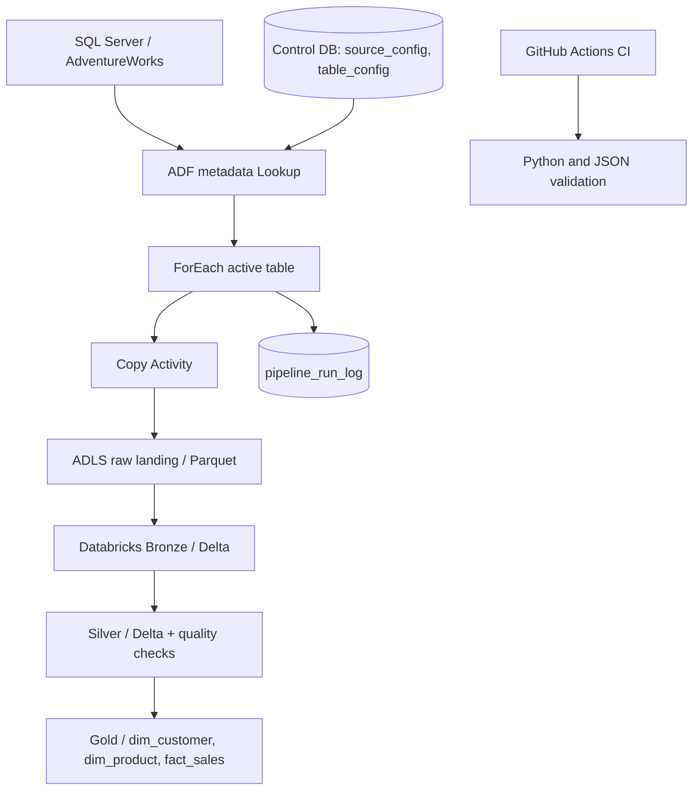

# AdventureWorks Metadata-Driven Lakehouse
**Portfolio starter blueprint — not a tested deployment package.**

An Azure Data Engineering reference project using SQL Server AdventureWorks, Azure Data Factory (ADF), ADLS Gen2, Azure Databricks, PySpark, SQL, Delta Lake, and GitHub Actions.

## Architecture

## Layers
- **Raw landing:** immutable/run-specific Parquet extracts.
- **Bronze:** source-aligned Delta data plus ingestion metadata.
- **Silver:** standardized, deduplicated, validated Delta entities.
- **Gold:** curated dimensions and fact table.

## Repository layout
- `docs/`: HLD, LLD, metadata design, deployment steps
- `sql/metadata/`: control database DDL and example seed
- `adf/`: ADF activity design and dynamic expression examples
- `databricks/`: Bronze, Silver, Gold, and reusable data quality helpers
- `config/`: sanitized example configuration
- `tests/`: lightweight tests
- `.github/workflows/`: CI validation

## Quick start
1. Review `docs/high-level-design.md` and `docs/metadata-framework.md`.
2. Run `sql/metadata/001_create_metadata_tables.sql` in a dedicated control database.
3. Review the sample seed script and confirm the AdventureWorks database/schema/table names.
4. Configure ADF linked services for SQL Server, control DB, and ADLS. Use Key Vault or managed identity; do not commit secrets.
5. Build the Lookup → ForEach → Copy flow following `adf/pipeline-design.md`.
6. Test one small full-load table; verify landing files and run logs.
7. Import/adapt the Databricks source files and run Bronze → Silver → Gold.
8. Add sanitized screenshots and actual run evidence.

## Security
Never commit credentials, access keys, SAS tokens, production data, or unsanitized logs. Use managed identity/Key Vault where supported and secret scopes or workload identity for Databricks.

## Validation status
This is a generated starter blueprint. No Azure resources or AdventureWorks environment were available to test deployment. Validate SQL, paths, schemas, permissions, runtime compatibility, ADF expressions, and rerun semantics before calling it production-ready.
